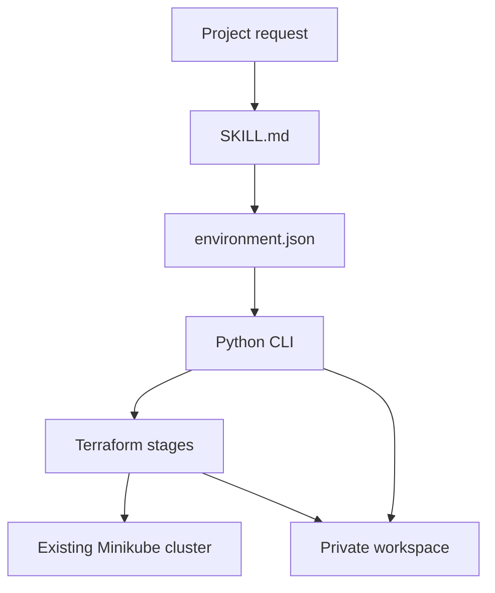

<!-- Purpose: Introduce the project, its architecture, supported scope, and first steps for GitHub readers. -->

# Local Kubernetes Platform

An agent skill for setting up PostgreSQL and Kafka on an existing Minikube cluster.

A local data platform needs storage, credentials, network rules, and monitoring to work together. This project brings those pieces into one configuration and a staged Terraform workflow. The agent helps choose settings and explain results. Python and Terraform handle the actual operations.

The aim is to reuse the same workflow across development projects. Each environment has its own configuration, state, plans, credentials, and reports.

The current build has passed static validation. Live deployment and functional acceptance are still pending.

## What it does

| Area | Current support |
|---|---|
| Configuration | Choose PostgreSQL, Kafka, or both. Set names, resource requests, storage, and application access. |
| Environment checks | Read cluster identity, ownership, node capacity, DNS, storage, and required operators. |
| PostgreSQL | One StatefulSet with persistent storage, TLS, an application login, and a separate monitoring login. |
| Kafka | One Strimzi KRaft broker/controller, with TLS users, topics, and scoped ACLs. |
| Storage | Reuse a checked `WaitForFirstConsumer` / `Retain` class, or create a separate Local Path provisioner. |
| Monitoring | Add PodMonitors and alert rules to an existing Prometheus installation. |
| Credentials | Prepare local PostgreSQL credentials and copy selected client credentials into the application namespace. |
| Changes | Save a plan, review its changes, and apply that exact plan. |
| Verification | Run read-only readiness checks and report functional checks that are still pending. |

Only one managed platform environment is supported per cluster. Keep one workspace for that environment and use it for later changes.

## What it does not do

- Create or recreate Kubernetes clusters, replace the CNI, or install and upgrade operators.
- Build application images, deploy applications, run schema migrations, or manage message formats.
- Provide PostgreSQL replication, Kafka replication, automatic failover, or production high availability.
- Set up HTTPS ingress, CNPG, object storage, WAL archiving, or point-in-time recovery.
- Automatically renew certificates, rotate credentials, run backups, or test restores.
- Run a full functional test suite for TLS, ACLs, network isolation, alerts, and recovery.
- Import existing resources, destroy environments, or automatically delete application data or retained volumes.

The current checks report basic Kubernetes readiness. They cannot establish that an application can connect or that a backup can be restored. See [verification and acceptance](references/operations.md#verification-and-acceptance) for the remaining checks.

## Architecture



`SKILL.md` tells the agent how to collect requirements, choose a workflow, and explain the result. The CLI can also run directly from a terminal.

`scripts/config.py` checks user input and fills in defaults. Other modules use that resolved configuration. Later checks cover files and live resources, which may change during a run.

`scripts/runtime.py` handles inspection, plan review, apply, and verification. `scripts/credentials.py` handles local certificates and fixed Secret writes.

`scripts/io_utils.py` provides private JSON storage, workspace locking, and subprocess calls. Child commands use argument lists without a shell wrapper. They have per-call timeouts and a `077` umask. These controls do not add a command sandbox. See the [I/O and subprocess reference](references/io.md) for the exact behavior and limits.

Terraform owns the selected Kubernetes resources. Each stage has a separate state file. Credential data stays outside Terraform.

| Stage | Responsibility | Included when |
|---|---|---|
| `00-bootstrap` | Namespaces, application identity, and network policies. | Always. |
| `05-storage` | A separate Local Path provisioner and storage class. | Storage mode is `create`. |
| `30-postgres` | PostgreSQL, its PVC, Services, and optional exporter. | PostgreSQL is enabled. |
| `31-kafka` | Kafka, topics, users, and network policies. | Kafka is enabled. |
| `40-monitoring` | PodMonitors and alert rules. | Monitoring is enabled. |

Stage sources are copied into a workspace outside this repository. That directory holds generated variables, state, saved plans, credentials, and reports. Packaged assets stay unchanged.

A saved plan records hashes of its inputs, sources, lockfiles, and prior state. It also records the target cluster identity. The apply step rejects a plan when those checks no longer match.

See [architecture and design decisions](references/design.md) for ownership rules and extension points.

## First steps

### Requirements

Offline configuration needs **Python 3.10 or later on macOS or Linux**. The Python scripts have no third-party runtime dependencies.

Cluster operations also need:

- Terraform `>=1.10,<2`, kubectl, and access to the pinned providers and images.
- An existing Minikube cluster with Calico. The current preflight accepts Kubernetes `1.35` through `1.37`.
- An explicit kubeconfig and context. Access must include cluster inventory and node capacity statistics.
- An existing Strimzi `1.3.0` operator when Kafka is enabled. It must run in the configured Kafka namespace.
- An existing Prometheus Operator installation when monitoring is enabled.
- OpenSSL when preparing PostgreSQL credentials locally.

Versions and image digests are listed in [the version record](assets/infra/versions.json). The Kafka profile uses Kafka `4.3.1`; PostgreSQL uses `17.11`.

### Prepare a configuration

Run these examples from the repository root. Copy the example outside the repository:

```sh
cp assets/environment.example.json ../demo-environment.json
```

Edit the copy before using it. The example enables PostgreSQL, Kafka, and monitoring. For PostgreSQL alone, set both `kafka.enabled` and `monitoring.enabled` to `false`.

Choose a stable `environment_id`. Set the real storage class and cluster context. For `storage.mode=create`, list existing nodes in `storage.nodes`. When Kafka is enabled, supply the checked API Service and endpoint `/32` addresses. The [configuration reference](references/configuration.md) explains these fields and their defaults.

Generate the local workspace:

```sh
python3 -B scripts/platform.py --config ../demo-environment.json --workspace "$HOME/local-k8s-workspaces/demo" configure
```

This command runs offline. It copies stage files and writes application interface records. For the first run, choose an empty workspace outside the repository. New directories request mode `0700`; JSON files request `0600`. The directory helper requires the current user's UID and no group or other permissions. It does not repair existing permissions.

### Inspect and plan

The next command reads the cluster:

```sh
python3 -B scripts/platform.py --config ../demo-environment.json --workspace "$HOME/local-k8s-workspaces/demo" inspect
```

Resolve the reported blockers, then plan the first stage:

```sh
python3 -B scripts/platform.py --config ../demo-environment.json --workspace "$HOME/local-k8s-workspaces/demo" plan --stage 00-bootstrap
```

Review the actual changes and plan ID. Later stages need their prerequisites to exist. PostgreSQL also needs its prepared Secrets before its stage can be planned.

`apply` shows a preview by default. Cluster changes require `--execute`. Credential publication uses the same explicit flag. Follow the [operations guide](references/operations.md) for the full sequence.

To use the project through an agent, point it to [SKILL.md](SKILL.md). Creating or unpacking this folder does not install the skill globally.

## Validation

Pull requests targeting `main` run the `CI` workflow. Its `Tests` job runs the offline Python suite, Terraform formatting, and the native Terraform validation matrix. Actions are pinned to commit hashes; Terraform uses the tested `1.15.8` release.

Required checks and review rules are GitHub repository settings. They are not defined by this workflow. The workflow alone does not block merges.

The recorded build passed **72 offline tests**. Native Terraform validation passed **12 configuration profiles and 40 stage instances**, with no errors or warnings. That run used Terraform `1.15.8` and Kubernetes provider `2.38.0`.

These results cover the implementation and static provider schema. This project has not completed live deployment or functional acceptance. The [validation report](references/validation.md) records the checks and their limits.

Run the offline tests:

```sh
python3 -B -m unittest discover -s tests -v
```

Run the Terraform validation matrix in a new private report directory:

```sh
python3 -B scripts/validate.py --report-dir "$HOME/local-k8s-validation/new-run"
```

The validator needs a Terraform release whose `validate` command supports `-var-file`. It first checks provider communication, then validates the selected stage copies. It does not contact Kubernetes. Use `--plugin-dir /path/to/mirror` to install providers from an offline mirror.

## Repository guide

| Path | Contents |
|---|---|
| [SKILL.md](SKILL.md) | Agent instructions and workflow selection. |
| `scripts/` | Configuration, execution, credentials, validation, and packaging tools. |
| `assets/infra/stacks/` | Terraform roots and PostgreSQL startup files. |
| [Configuration reference](references/configuration.md) | Input fields, defaults, supported combinations, and application access. |
| [Operations guide](references/operations.md) | Command effects, deployment order, credentials, and verification. |
| [I/O and subprocess reference](references/io.md) | Private file handling, locks, command environments, and timeouts. |
| [Design notes](references/design.md) | Architecture, ownership, and scope decisions. |
| [Validation report](references/validation.md) | Observed results and evidence. |
| `tests/` | Offline tests and fake external tools. |

To build a portable skill archive:

```sh
python3 -B scripts/package.py --output dist/local-k8s-platform.tar.gz
```

The archive includes the skill, scripts, Terraform assets, references, tests, and provider lockfiles. It also contains a checksum manifest. Local editor and agent settings, virtual environments, caches, test output, credentials, Terraform state, and saved plans are excluded from Git and archives. The archive builder applies its own filters without requiring Git.
