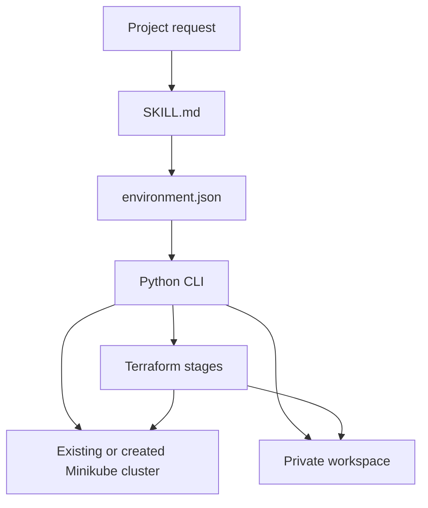

<!-- Purpose: Introduce the project, its architecture, supported scope, and first steps for GitHub readers. -->

# Local Kubernetes Platform

An agent skill for creating or reusing a local Minikube cluster and setting up PostgreSQL, Kafka, and an optional GPU device plugin on it.

A local data platform needs storage, credentials, network rules, and monitoring to work together. This project brings those pieces into one configuration and a staged Terraform workflow. The agent helps choose settings and explain results. Python and Terraform handle the actual operations.

The aim is to reuse the same workflow across development projects. Each environment has its own configuration, state, plans, credentials, and reports.

Defaults target small local workloads. PostgreSQL requests 256Mi of memory and Kafka requests 512Mi. Each uses a 1Gi PVC. The example reuses an existing Minikube CSI driver. Training jobs, model weights, datasets, and checkpoints have separate resource budgets. See the [small local training guide](references/local-training.md).

Live runs on 2026-11-22 and 2026-11-23 created a three-node krunkit Minikube profile and deployed every stage, including the GPU plugin. Readiness checks, Prometheus scraping, and the GPU smoke test passed. Those runs predate the functional acceptance runner. Its PostgreSQL and Kafka checks have passed offline tests only and still need a live run. PostgreSQL backup and restore drills are implemented but have also passed offline tests only. NetworkPolicy traffic and alert delivery have no runner yet. See [Validation](references/validation.md).

## What it does

| Area | Current support |
|---|---|
| Cluster | Reuse an existing Minikube cluster, or create a new, explicitly named profile through a reviewed plan. A separately reviewed `--overwrite` plan recreates that profile when it is missing or no longer matches the workspace records. The previous workspace is archived. A separately reviewed `delete` plan deletes the profile and keeps, archives, or purges the workspace files. |
| Configuration | Choose PostgreSQL, Kafka, the GPU plugin, or any combination. Set names, resource requests, storage, and application access. |
| Environment checks | Read cluster identity, ownership, node capacity, DNS, storage, and required operators. |
| Prerequisites | Reuse compatible installations or prepare reviewed plans for missing Operators, minimal Prometheus, and local OpenSSL. |
| PostgreSQL | One StatefulSet with persistent storage, TLS, an application login, and a separate monitoring login. |
| Kafka | One Strimzi KRaft broker/controller, with TLS users, topics, and scoped ACLs. |
| Storage | Reuse a checked class, create a class using the existing CSI driver, or install a separate Local Path provisioner. |
| Monitoring | Add PodMonitors and alert rules to an existing Prometheus installation. |
| GPU | Advertise the krunkit render device as `devic.es/dri` through a device plugin on selected nodes, and run an authorized smoke-test Pod. See [GPU device plugin](references/gpu.md). |
| Credentials | Prepare local PostgreSQL credentials, copy selected client credentials into the application namespace, and report certificate expiry and stale copies (read-only). |
| PostgreSQL recovery | Through reviewed plans, take a checksummed logical backup to a private host directory and restore a verified snapshot in a network-isolated local Docker container and compare row counts and a fixture row. |
| Changes | Save a plan, review its changes, and apply that exact plan. |
| Verification | Run read-only readiness checks per object, read actual Prometheus targets when reachable, and report functional checks separately from pending ones. |
| Functional acceptance | Through a reviewed plan, test PostgreSQL `verify-full`, wrong-CA rejection, and role limits, and Kafka mTLS, fixture produce/consume, and ACL rejection. It uses labeled fixtures it removes afterward. |

Only one managed platform environment is supported per cluster. Keep one workspace for that environment and use it for later changes.

## What it does not do

- Start, resize, or delete clusters it did not create, replace the CNI, or replace and upgrade operators. Recreating or deleting its own profile requires an explicit, reviewed `cluster --overwrite` or `delete` plan.
- Build application images, deploy applications, run schema migrations, or manage message formats.
- Provide PostgreSQL replication, Kafka replication, automatic failover, or production high availability.
- Set up HTTPS ingress, CNPG, object storage, WAL archiving, or point-in-time recovery.
- Automatically renew certificates, rotate credentials, or schedule backups. Renewal follows a documented manual order; backups and restore drills run on request.
- Back up Kafka messages or offsets. See the [Kafka data recovery boundary](references/operations.md#kafka-data-recovery-boundary).
- Test NetworkPolicy traffic, alert delivery, or backup and restore automatically. The acceptance runner covers PostgreSQL and Kafka client behavior only.
- Import existing resources, destroy environments, or automatically delete application data or retained volumes.

Readiness checks alone cannot establish that an application can connect or that a backup can be restored. The acceptance runner covers client connections; restores still need separate evidence. See [verification and acceptance](references/operations.md#verification-and-acceptance) for the remaining checks.

## Architecture



`SKILL.md` tells the agent how to collect requirements, choose a workflow, and explain the result. The CLI can also run directly from a terminal.

`scripts/config.py` checks user input and fills in defaults. Other modules use that resolved configuration. Later checks cover files and live resources, which may change during a run.

`scripts/cluster.py` plans and creates a new Minikube profile, and handles reviewed overwrites and deletions of a profile it created. `scripts/runtime.py` handles inspection, plan review, apply, and verification. `scripts/acceptance.py` runs reviewed functional acceptance with fixtures it removes afterward. `scripts/recovery.py` handles PostgreSQL backups and restore drills. `scripts/gpu.py` runs the GPU smoke test. `scripts/prerequisites.py` prepares reviewed dependency installs. `scripts/credentials.py` handles local certificates and fixed Secret writes.

`scripts/capacity.py` estimates placement for individual Pods and volumes. It checks measured free memory, assigned Pod requests, disk headroom, and selected storage nodes. The estimate reports remaining capacity. Actual Kubernetes scheduling and runtime behavior still need verification.

`scripts/io_utils.py` provides private JSON storage, workspace locking, and subprocess calls. Child commands use argument lists without a shell wrapper. They have per-call timeouts and a `077` umask. These controls do not add a command sandbox. See the [I/O and subprocess reference](references/io.md) for the exact behavior and limits.

Terraform owns the data-platform stage resources. Each stage has a separate state file. Prerequisite resources use create-only operations and separate review records. Credential data stays outside Terraform.

| Stage | Responsibility | Included when |
|---|---|---|
| `00-bootstrap` | Namespaces, application identity, and network policies. | Always. |
| `05-storage` | A separate Local Path provisioner and storage class. | Storage mode is `create`. |
| `05-storage-csi` | A retained worker-scoped class using the existing CSI driver. | Storage mode is `csi`. |
| `20-gpu` | The GPU device plugin DaemonSet in its own namespace. | GPU is enabled. |
| `30-postgres` | PostgreSQL, its PVC, Services, and optional exporter. | PostgreSQL is enabled. |
| `31-kafka` | Kafka, topics, users, and network policies. | Kafka is enabled. |
| `40-monitoring` | PodMonitors and alert rules. | Monitoring is enabled. |

Stage sources are copied into a workspace outside this repository. That directory holds generated variables, state, saved plans, credentials, and reports. Packaged assets stay unchanged.

A saved plan records hashes of its inputs, sources, lockfiles, and prior state. It also records the target cluster identity. The apply step rejects a plan when those checks no longer match.

See [architecture and design decisions](references/design.md) for ownership rules and extension points.

## First steps

### Requirements

Offline configuration needs **Python 3.10 or later on macOS or Linux**. The Python scripts have no third-party runtime dependencies.

Cluster operations also need:

- Terraform `>=1.10,<2`, kubectl, and access to the pinned providers and images.
- An existing Minikube cluster with Calico, or minikube and a working driver to create one. The current preflight accepts Kubernetes `1.35` through `1.37`.
- An explicit kubeconfig and context. Access must include cluster inventory and node capacity statistics.

The skill can prepare these additional dependencies through a reviewed plan:

- Strimzi `1.3.0` and its CRDs when Kafka is enabled. The Operator runs in the configured Kafka namespace.
- Prometheus Operator and a minimal Prometheus instance when monitoring is enabled.
- Local OpenSSL for PostgreSQL credential preparation, through an existing supported package manager.

Compatible existing installations are reused. New monitoring installations use Prometheus Operator `v0.95.2` and Prometheus `v3.16.0`. The [prerequisite guide](references/prerequisites.md) covers scope, permissions, local package managers, and recovery.

Versions and image digests are listed in [the version record](assets/infra/versions.json). The Kafka profile uses Kafka `4.3.1`; PostgreSQL uses `17.11`.

### Prepare a configuration

Run these examples from the repository root. Copy the example outside the repository:

```sh
cp assets/environment.example.json ../demo-environment.json
```

Edit the copy before using it. The example enables PostgreSQL, Kafka, and monitoring. For PostgreSQL alone, set both `kafka.enabled` and `monitoring.enabled` to `false`.

Choose a stable `environment_id` and the actual cluster context. The example uses `storage.mode=csi` with workers `minikube-m02` and `minikube-m03`. Review those names and the existing driver. For `storage.mode=reuse`, supply a reviewed WFFC/Retain class. For `storage.mode=create`, select nodes for a new Local Path controller. When Kafka is enabled, supply the checked API Service and endpoint `/32` addresses. The [configuration reference](references/configuration.md) explains these fields and their defaults.

To create a new cluster instead, start from `assets/environment.create.example.json`. Set `cluster.mode=create`, an explicit `cluster.name`, and `cluster.create.driver`. After `configure`, review and execute the cluster plan before any other cluster step:

```sh
python3 -B scripts/platform.py --config ../demo-environment.json --workspace "$HOME/local-k8s-workspaces/demo" cluster
python3 -B scripts/platform.py --config ../demo-environment.json --workspace "$HOME/local-k8s-workspaces/demo" cluster --plan-id REVIEWED_PLAN_ID --execute
```

Conflicting profiles, planned machine names, or kubeconfig entries block creation. Later operations use the identity recorded when the cluster was created. See [Create a Minikube cluster](references/operations.md#create-a-minikube-cluster).

Generate the local workspace:

```sh
python3 -B scripts/platform.py --config ../demo-environment.json --workspace "$HOME/local-k8s-workspaces/demo" configure
```

This command runs offline. It copies stage files and writes application interface records. For the first run, choose an empty workspace outside the repository. New directories request mode `0700`; JSON files request `0600`. The directory helper requires the current user's UID and no group or other permissions. It does not repair existing permissions.

### Prepare prerequisites, inspect, and plan

First prepare a prerequisite plan for the enabled components:

```sh
python3 -B scripts/platform.py --config ../demo-environment.json --workspace "$HOME/local-k8s-workspaces/demo" prerequisites
```

Review its target, resource list, package commands, and plan ID. After that exact change is authorized:

```sh
python3 -B scripts/platform.py --config ../demo-environment.json --workspace "$HOME/local-k8s-workspaces/demo" prerequisites --plan-id REVIEWED_PLAN_ID --execute
```

Use `--component openssl` to prepare only the local tool without accessing Kubernetes. Both preview and execution use the same component selection. The example budget is 2048Mi. Data services request 1088Mi with monitoring enabled. Installing both Operators and minimal Prometheus adds 756Mi, for 1844Mi in total. Externally reused services still consume live cluster capacity. The CSI class adds no new controller Pod.

The next command reads the cluster:

```sh
python3 -B scripts/platform.py --config ../demo-environment.json --workspace "$HOME/local-k8s-workspaces/demo" inspect
```

Resolve the reported blockers, then plan the first stage:

```sh
python3 -B scripts/platform.py --config ../demo-environment.json --workspace "$HOME/local-k8s-workspaces/demo" plan --stage 00-bootstrap
```

Review the actual changes and plan ID. Later stages need their prerequisites to exist. PostgreSQL also needs its prepared Secrets before its stage can be planned.

`apply` shows a preview by default. Cluster changes require `--execute`. Credential publication uses the same explicit flag. Follow the [operations guide](references/operations.md) for the full sequence.

To use the project through an agent, point it to [SKILL.md](SKILL.md). Creating or unpacking this folder does not install the skill globally.

## Validation

Pull requests targeting `main` run the `CI` workflow. Its `Tests` job runs the offline Python suite, Terraform formatting, and the native Terraform validation matrix. Actions are pinned to commit hashes; Terraform uses the tested `1.15.8` release.

Required checks and review rules are GitHub repository settings. They are not defined by this workflow. The workflow alone does not block merges.

On 2026-11-26 the current build passed **241 offline tests** on Python `3.10.11`. Prerequisite, cluster, acceptance, and recovery tests use fake Kubernetes, Minikube, Docker, and package tools. The most recent native Terraform run (2026-11-23) passed **20 configuration profiles and 71 stage instances**, with no errors or warnings, on Terraform `1.15.8` and Kubernetes provider `2.38.0`.

Live deployment of every stage passed readiness checks on a three-node krunkit profile on 2026-11-22 and 2026-11-23. Live functional acceptance is pending. The [validation report](references/validation.md) records each check with its date and scope.

Run the offline tests:

```sh
python3 -B -m unittest discover -s tests -v
```

Run the Terraform validation matrix in a new private report directory:

```sh
python3 -B scripts/validate.py --report-dir "$HOME/local-k8s-validation/new-run"
```

The validator needs a Terraform release whose `validate` command supports `-var-file`. It first checks provider communication, then validates the selected stage copies. It does not contact Kubernetes. Use `--plugin-dir /path/to/mirror` to install providers from an offline mirror.

## Repository guide

| Path | Contents |
|---|---|
| [SKILL.md](SKILL.md) | Agent instructions and workflow selection. |
| `scripts/` | Configuration, execution, credentials, validation, and packaging tools. |
| `assets/infra/stacks/` | Terraform roots and PostgreSQL startup files. |
| [Configuration reference](references/configuration.md) | Input fields, defaults, supported combinations, and application access. |
| [Small local training guide](references/local-training.md) | Small defaults, existing CSI, worker placement, and data preservation. |
| [Operations guide](references/operations.md) | Command effects, deployment order, credentials, and verification. |
| [Prerequisite guide](references/prerequisites.md) | Dependency plans, reuse, installation, local OpenSSL, and recovery. |
| [I/O and subprocess reference](references/io.md) | Private file handling, locks, command environments, and timeouts. |
| [Design notes](references/design.md) | Architecture, ownership, and scope decisions. |
| [Validation report](references/validation.md) | Observed results and evidence. |
| `tests/` | Offline tests and fake external tools. |

To build a portable skill archive:

```sh
python3 -B scripts/package.py --output dist/local-k8s-platform.tar.gz
```

The archive includes the skill, scripts, Terraform assets, references, tests, and provider lockfiles. It also contains a checksum manifest. Local editor and agent settings, virtual environments, caches, test output, credentials, Terraform state, and saved plans are excluded from Git and archives. The archive builder applies its own filters without requiring Git.
