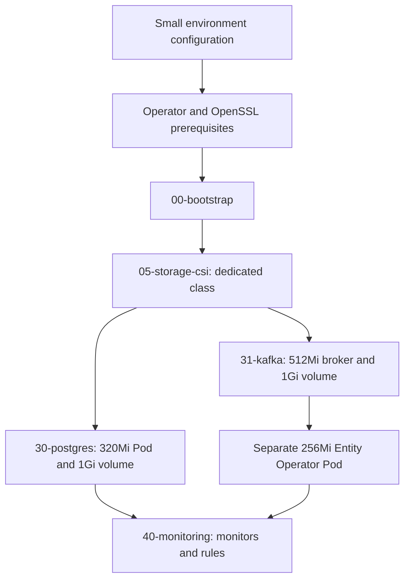

<!-- Purpose: Describe the small training-platform profile, existing CSI reuse, and stage-specific resource checks. -->

# Small local training platform

Use this profile for metadata and message services on an existing Minikube cluster.
Training jobs, datasets, model weights, and checkpoints have separate budgets.
Small models still need resources that depend on their framework and training job.

## Default requests

| Workload | Memory request / limit | Persistent storage |
|---|---|---|
| PostgreSQL | 256Mi / 512Mi | 1Gi |
| PostgreSQL exporter, when enabled | 64Mi / 128Mi in the PostgreSQL Pod | None |
| Kafka broker/controller | 512Mi / 768Mi | 1Gi |
| Kafka Entity Operator | Two 128Mi requests in a separate Pod | None |

The combined data services request 1088Mi when monitoring is enabled. Compatible
existing Operators and Prometheus are reused. A new CSI StorageClass needs no new
controller Pod. The memory budget is 2048Mi and the disk reserve is 512Mi per used
node. Budget checks and measured capacity checks serve different purposes.

PostgreSQL uses 20 connections, 64MB shared buffers, 2MB work memory, and a 128MB WAL
size target. Kafka uses a 256Mi heap. New Topics use one partition, six-hour
retention, a 64Mi retention target per partition, and 16Mi log segments. Retention
settings and PVC requests are not hard filesystem quotas.

## Use the existing CSI driver

The example selects `storage.mode=csi`. This mode requires the existing
`hostpath.csi.k8s.io` driver. Inspection checks its DaemonSet, node registration,
and topology labels. It creates a dedicated class with `WaitForFirstConsumer` and
`Retain`. Existing classes keep their owners and settings.

```json
{
  "$comment": "Purpose: illustrate the storage portion of the small local profile.",
  "storage": {
    "mode": "csi",
    "class": "example-dev-local-retain",
    "nodes": ["minikube-m02", "minikube-m03"]
  }
}
```

Use actual node names. This is a configuration fragment, not a complete input.
The chosen nodes constrain both the class topology and PostgreSQL/Kafka affinity.
The data Pods cannot use a different node merely because it has more free memory.
The Minikube CSI Hostpath driver supports multi-node clusters.
See the [upstream guide](https://minikube.sigs.k8s.io/docs/tutorials/volume_snapshots_and_csi/).

## Check the operation being planned



`prerequisites` checks new dependency Pods and their temporary storage. It does not
reserve future database volumes. `plan` and `apply` check the selected stage.
`inspect` gives the full remaining platform forecast.

The capacity report includes measured free memory and memory available for
scheduling after existing requests. It places each forecast Pod and volume once.
It also shows the remaining capacity for each node. This is an estimate. It does
not reserve those resources or prove that a training job will run.

For example, a low-disk control node can host the Entity Operator while the two
workers host the database volumes. The estimate does not require every node to
fit all volumes, or a single node to fit the broker and Entity Operator together.

## Prepare and review

Copy `assets/environment.example.json` outside the packaged assets. Review the
context, worker names, API `/32` addresses, and selected services. Keep the same
workspace for the environment.

```sh
python3 -B scripts/platform.py --config environment.json --workspace /private/path/foo-dev configure
python3 -B scripts/platform.py --config environment.json --workspace /private/path/foo-dev prerequisites
python3 -B scripts/platform.py --config environment.json --workspace /private/path/foo-dev inspect
```

If prerequisites need installation, review and execute that exact plan before
full inspection. Then plan bootstrap, the CSI class, credentials, and data services
in order. The [operations guide](operations.md) covers plan IDs and authorization.

## Existing data

Changing defaults does not authorize a data migration. Keep existing PVC sizes,
Topic partitions, and message retention when updating an old environment. Use
explicit Kafka configuration values to preserve its old settings. The workflow
rejects automatic volume shrinking, storage moves, and destructive Topic changes.

The new defaults need runtime acceptance on the selected environment. Ready Pods
still need connection, authentication, permission, and monitoring checks.
