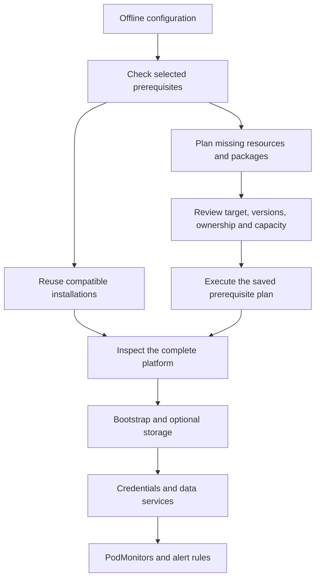

<!-- Purpose: Explain reviewed prerequisite installation, reuse, local tool setup, and recovery. -->

# Prepare prerequisites

Use `scripts/platform.py prerequisites` after offline configuration. The command
selects dependencies from the existing component flags. It needs no additional
configuration fields.

| Selection | Work |
|---|---|
| PostgreSQL enabled | Resolve local OpenSSL or plan its package installation. |
| Kafka enabled | Reuse Strimzi 1.3.0, or plan its Operator, CRDs and RBAC. |
| Monitoring enabled | Reuse Prometheus Operator and a matching Prometheus instance, or prepare missing resources. |

## Workflow



Run examples from the skill root. Use the same configuration and private workspace
for all commands.

```sh
python3 -B scripts/platform.py --config environment.json --workspace /private/path/foo-dev prerequisites
```

The default action reads local tools and the selected cluster. It checks existing
resources and create permissions. It saves an exact resource list, target identity,
source hashes, and a plan ID. It prints resource references and package commands.
Full manifests stay in the private review file.
When the change list is empty, continue to `inspect`; no installation is needed.

Permission checks use non-persistent `SelfSubjectAccessReview` requests with an
explicit API group. They work before the selected CRDs are installed. These
authorization requests do not create managed resources.

Prerequisite planning checks the current dependency operation. Missing target
Operators do not block their own installation plan. Cluster identity, Minikube,
Calico, DNS, ownership, and capacity for new dependency Pods still need to pass.
Future PostgreSQL and Kafka volumes do not block Operator preparation. Their
StorageClass and volume placement are checked in the data stages.

Preview a saved plan without another cluster read:

```sh
python3 -B scripts/platform.py --config environment.json --workspace /private/path/foo-dev prerequisites --plan-id REVIEWED_PLAN_ID
```

Review the actual changes before execution. Authorization covers the listed local
package commands, namespaces, cluster-scoped CRDs, RBAC, and workloads. Preparing
files or enabling a component does not authorize these writes.

```sh
python3 -B scripts/platform.py --config environment.json --workspace /private/path/foo-dev prerequisites --plan-id REVIEWED_PLAN_ID --execute
```

Execution repeats live checks. Changed configuration, sources, target identity,
resource ownership, or resource contents require a fresh plan. The plan is consumed
before the first write. Resources use atomic `kubectl create` calls. Existing
resources are never patched, imported, replaced, or deleted.

Use `--component strimzi`, `--component monitoring`, or `--component openssl` for a
single dependency. Repeat the same selection when previewing or executing its plan.
A disabled component is rejected at the CLI entry point.

## Operators and namespaces

The packaged [version record](../assets/infra/versions.json) pins source bundles,
manifest checksums, and image digests. Installation reads packaged JSON and needs
no Helm binary or Python YAML package. Provider and container downloads still need
access to their registries.

Strimzi runs in `kafka.namespace`. New installations watch that namespace through
the Pod namespace field. Reuse requires one Strimzi 1.3.0 Operator in that namespace,
a matching watch scope, and established `v1` CRDs. Discovery includes Deployments
in all namespaces, so an Operator elsewhere cannot trigger a duplicate install.

New Prometheus Operator installations use version `v0.95.2`. Its upstream v0.95.1 images were published for linux/amd64 only and could not start on arm64 nodes. They watch
`monitoring.namespace` and do not manage kubelet Services. New Prometheus instances
use version `v3.16.0`. Their Pod labels match `monitoring.pod_labels`. Their monitor
and rule selectors match `monitoring.release` in the monitoring namespace.

The minimal Prometheus instance requests 256Mi of memory. Its config reloader
requests 16Mi when the packaged Operator is used. The Operator requests 100Mi.
Strimzi requests 384Mi. These requests count toward the configured memory budget.
Previously installed, owned prerequisites also count when planning another
component. Externally owned reused services are excluded from that budget, but
their current use affects measured free capacity.

The default combined data-service profile requests 1088Mi. Installing both
Operators and Prometheus adds 756Mi, for a total of 1844Mi. The example and
configuration default use a 2048Mi memory budget.
A budget does not prove that the selected nodes have enough memory.

Prometheus uses temporary storage, a six-hour retention period, and a 256MB
retention-size setting. The plan reserves another 512Mi of disk demand. Metrics
can disappear when Pods move or restart. Alert delivery, dashboards, and durable
metrics storage need separate configuration.

Compatible external installations keep their owners. A missing Prometheus instance
can be added while reusing an existing Operator. A conflicting existing instance
or an Operator with unsupported instance filters blocks preparation. Partial CRDs
with unknown ownership also block it.

The strict `inspect` action still requires complete ready dependencies. It checks
actual Prometheus Pods and the selectors used by the planned monitors and rules.
Readiness does not prove that metrics are scraped or alerts are delivered.

## Local OpenSSL

```sh
python3 -B scripts/platform.py --config environment.json --workspace /private/path/foo-dev prerequisites --component openssl
```

This selection does not read Kubernetes or require a working kubeconfig. It checks
the required certificate commands, not just the executable name. PATH is checked
first. A keg-only Homebrew OpenSSL is also supported. Credential preparation uses
the resolved executable path without changing global PATH or shell files.

When OpenSSL is missing, the plan uses an existing package manager:

| Host | Planned installation |
|---|---|
| macOS | Homebrew `install openssl@3`. Automatic update and cleanup are disabled. |
| Linux with apt-get | `install --yes --no-install-recommends openssl`. |
| Linux with dnf | `install --assumeyes openssl`. |

The package manager selects the package version and dependencies at execution.
The plan fixes the command; it does not pin the operating system repository.
Package managers are never installed by this workflow. Linux uses existing root
access or `sudo -n`. If interactive authentication is needed, establish that access
outside the helper and prepare a new plan. No password prompt is handled by the
script. Package commands have a ten-minute timeout.

After executing the reviewed local plan, run `credentials --prepare` as before.
The credential helper resolves OpenSSL once per preparation or bundle validation.
It passes that path to all certificate commands.

## Failure and recovery

Readiness waits allow 600 seconds per resource, because first image pulls on a local VM can take minutes. A timeout reports the pending resource. Check its Pod events for slow or failed image pulls before preparing a new plan.

Results are written after each creation. See
`reports/prerequisites-<component>.json` and the consumed plan record under
`plans/prerequisites/`. A timeout or interrupted command can leave an uncertain
result. Inspect the actual resources before generating a fresh plan.

A fresh plan can resume this environment's partial installation. Existing owned
resources must still match the desired manifests. Changed or foreign resources
block recovery. The helper preserves completed resources and never rolls them
back or removes data. Resource checks and create calls are separate requests;
they do not lock the cluster against other administrators.

## Example agent request

```text
Use $local-k8s-platform to prepare a small local training platform on my existing
Minikube cluster. Reuse compatible Operators and the existing CSI Hostpath driver.
Use 1Gi PVCs for new PostgreSQL and Kafka services and select the actual worker
nodes. Check individual Pod and volume placement. Show resource headroom and
review the exact prerequisite and Terraform plans before execution.
```

For upstream context, see [Strimzi 1.3.0 installation](https://strimzi.io/docs/operators/1.3.0/deploying),
[Prometheus Operator installation](https://prometheus-operator.dev/docs/getting-started/installation/),
and [Prometheus deployment](https://prometheus-operator.dev/docs/platform/platform-guide/).
